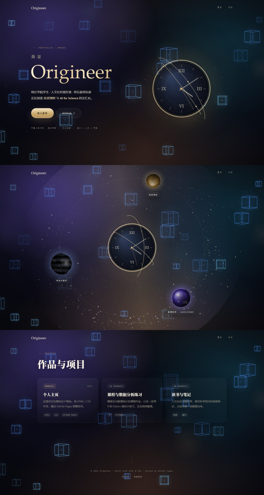

# Origineer-Official.github.io

> 我的个人主页 · My personal homepage

🔗 在线访问：<https://origineer-official.github.io>



## 关于

中国人民大学统计学院大二在读。关注人文社科、音乐与游戏，未来希望在投资理财与 AI4Science 方向深入学习和研究。

## 页面结构

整站是三块整屏页面，点击导航或「进入星系」切换，不靠上下滚动：

1. **首屏**：悬浮的**浑天仪时钟**，Canvas 三维绘制 —— 两道黄铜环以不同倾角绕轴旋转，前后半环分开绘制形成遮挡；表盘正对镜头（近似正圆），按真实时间走动的时分秒针。
2. **星系**：同一座时钟缩小成为中心；三颗行星以**等边三角形**队形绕行，按相对时钟的方位做明暗；外围是 420 颗星尘组成的**小行星带**与两条外环，背景铺了 1600 颗银河颗粒。
3. **作品**：卡片陈列与页脚。

点击行星放大进入详情，每颗星球有独立的动态背景，且**随内容滚动产生视差**：

- 黑色：漂浮音符与数据闪烁
- 金色：滚动的 K 线与均线
- 蓝紫：DNA 双螺旋与碱基数据

背景星场里另有 24 枚**蓝色线框立方体**，缓慢自转并闪烁。

## 技术栈

纯静态站点，无框架、无构建步骤：

- **HTML5** — 语义化结构 + `<template>` 存放行星详情内容
- **CSS3** — 自定义属性、渐变文字、毛玻璃、视差与过渡、响应式布局
- **原生 JavaScript + Canvas 2D** — 三维浑天仪投影、星图与行星光照、背景星场、`requestAnimationFrame` 动画
- **GitHub Pages** — 静态托管

## 本地预览

直接双击 `index.html` 即可，或在目录下启动一个本地服务器：

```bash
python -m http.server 8000
```

然后访问 <http://localhost:8000>。

## 文件结构

```
.
├── index.html   # 页面结构与三颗行星的详情模板
├── style.css    # 全部样式
├── script.js    # 浑天仪、星图、弹窗与背景动画
├── preview.jpg  # 整页预览图
└── README.md
```

## 设计说明

- 页面内容集中在 `index.html`，三颗行星的详情分别写在 `tpl-self` / `tpl-finance` / `tpl-data` 三个 `<template>` 中。
- 配色为「午夜 + 黄铜 + 象牙」，变量位于 `style.css` 顶部的 `:root`。
- 浑天仪与星图都由 Canvas 2D 绘制：`script.js` 里的 `Orrery`（三维旋转 + 透视投影）与 `Galaxy`（星空 / 行星光照 / 轨道）。
- 行星公转参数在 `PLANETS` 数组（`a`/`b` 为椭圆半径比，`period` 为公转秒数）。
- 所有动画都遵循 `prefers-reduced-motion`，系统开启「减少动态效果」时自动关闭。

## License

个人主页内容版权归作者所有。
