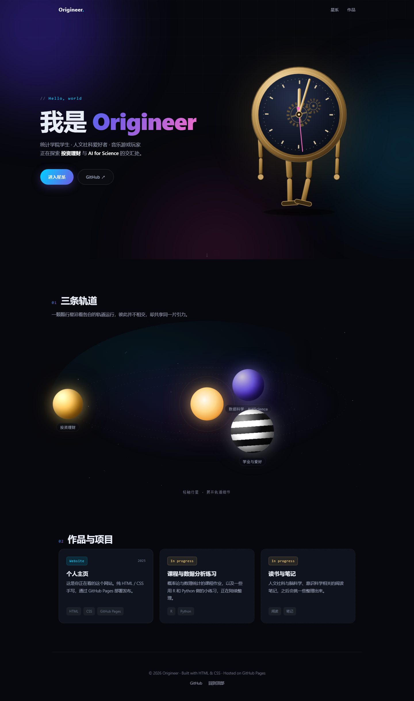

# Origineer-Official.github.io

> 我的个人主页 · My personal homepage

🔗 在线访问：<https://origineer-official.github.io>



## 关于

中国人民大学统计学院大二在读。关注人文社科、音乐与游戏，未来希望在投资理财与 AI4Science 方向深入学习和研究。

## 页面结构

- **首屏**：一只会走路的机械时钟，齿轮转动、指针走时、双腿交替迈步。
- **星系**：三颗行星沿各自轨道公转，对应三条线索 ——
  - 黑白行星：学业与爱好
  - 金色行星：投资理财
  - 蓝紫行星：数据科学 · AI4Science
- **行星详情**：点击行星后画面放大进入，每颗星球有独立的动态背景：
  - 黑白：漂浮音符与数据闪烁
  - 金色：滚动的 K 线与均线
  - 蓝紫：DNA 双螺旋与碱基数据
- **作品与项目**：卡片式陈列。

## 技术栈

纯静态站点，无框架、无构建步骤：

- **HTML5** — 语义化结构 + `<template>` 存放行星详情内容
- **CSS3** — 自定义属性、渐变文字、毛玻璃、SVG 关键帧动画、响应式布局
- **原生 JavaScript** — Canvas 星场与公转轨道、`requestAnimationFrame` 动画、模态窗交互
- **GitHub Pages** — 静态托管

## 本地预览

直接双击 `index.html` 即可，或在目录下启动一个本地服务器：

```bash
python -m http.server 8000
```

然后访问 <http://localhost:8000>。

## 文件结构

```
.
├── index.html   # 页面结构与三颗行星的详情模板
├── style.css    # 全部样式，含时钟与星系动效
├── script.js    # 行星公转、模态窗、Canvas 背景动画
├── preview.png  # 整页预览图
└── README.md
```

## 设计说明

- 页面内容集中在 `index.html`，三颗行星的详情分别写在 `tpl-self` / `tpl-finance` / `tpl-data` 三个 `<template>` 中。
- 配色变量位于 `style.css` 顶部的 `:root`（`--c1` / `--c2` / `--c3` / `--gold` / `--violet`）。
- 所有动画都遵循 `prefers-reduced-motion`，系统开启「减少动态效果」时自动关闭。

## License

个人主页内容版权归作者所有。
